# Despliegue de la PokeDex en Azure Static Web Apps

Guía paso a paso del despliegue de la aplicación PokeDex (Angular 14) en **Azure Static Web Apps**, con los comandos y la configuración utilizados.

- **URL pública:** https://calm-ground-0a90eb710.5.azurestaticapps.net
- **Repositorio:** https://github.com/luisabelherrera/pokedex
- **Creación de la cuenta en Azure:** ver [README.md](README.md)

## Arquitectura

```
Usuario ──HTTPS──▶ Azure Static Web Apps (swa-pokedex-portal-prod-lh, plan Free, CDN global)
                         │  sirve los archivos estáticos de dist/pokedex-angular
                         │  aplica los encabezados de staticwebapp.config.json
                         ▼
Navegador ──HTTPS──▶ PokeAPI (pokeapi.co / beta.pokeapi.co)   ← datos de los Pokémon
```

¿Por qué Static Web Apps? Una vez compilada, la PokeDex es solo HTML, CSS y JavaScript. Static Web Apps es gratis, incluye HTTPS y CDN, y permite configurar encabezados de seguridad. Corresponde al laboratorio *1.1 Despliegue de una Static Web App en Azure*.

---

## Paso 1. Crear el repositorio `pokedex` y subir el código

1. En GitHub, crear un repositorio **público** llamado `pokedex`, sin README, .gitignore ni licencia.

   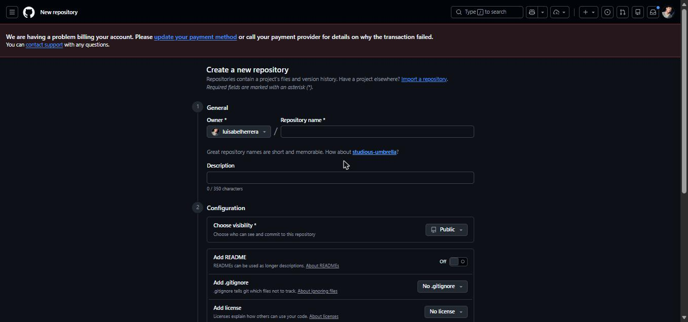

2. Descargar solo la carpeta del código fuente del repositorio del profesor y subirla al repositorio propio. Comandos en CMD de Windows:

   ```bat
   git clone --depth 1 --filter=blob:none --sparse https://github.com/rcuello/ac4dem1a.git
   cd ac4dem1a
   git sparse-checkout set sistemas-distribuidos/poke-dex-lab
   cd ..
   xcopy ac4dem1a\sistemas-distribuidos\poke-dex-lab\source\pokedex-angular pokedex\ /E /I /H
   cd pokedex
   git init
   git add .
   git commit -m "Codigo fuente PokeDex"
   git branch -M main
   git remote add origin https://luisabelherrera@github.com/luisabelherrera/pokedex.git
   git push -u origin main
   ```

   > Si `git push` devuelve **403**, Windows tiene guardadas las credenciales de otra cuenta. Incluir el usuario en la URL del remoto (`https://usuario@github.com/...`) obliga a autenticarse con la cuenta correcta.

   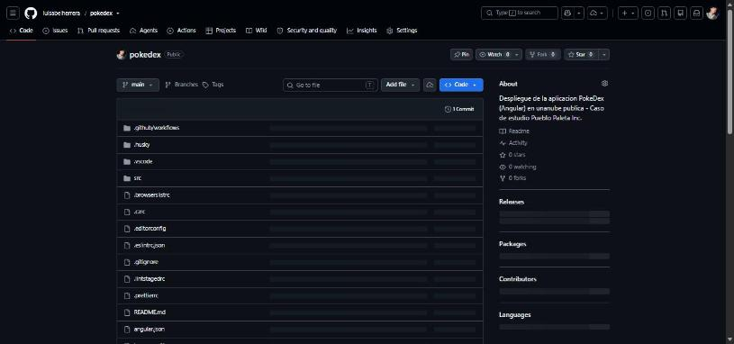

## Paso 2. Adaptar el código para Azure y agregar seguridad

El código venía preparado para GitHub Pages. Se hicieron estos cambios:

| Archivo | Cambio | Motivo |
|---|---|---|
| `src/environments/environment.prod.ts` | `imagesPath: '/assets/images'` | La ruta `/pokedex-angular/assets/images` era la de GitHub Pages; en Azure las imágenes salían rotas. |
| `src/index.html` | Se eliminó el script inline "Single Page Apps for GitHub Pages" | No hace falta en Azure y permite una CSP con `script-src 'self'`. |
| `angular.json` | `"inlineCritical": false` y `src/staticwebapp.config.json` en `assets` | Evita el `onload` inline que bloquearía la CSP y copia la configuración al build. |
| `src/staticwebapp.config.json` | Archivo nuevo | Encabezados de seguridad y fallback de rutas para Angular. |
| `.github/workflows/pipelines.yml` | Eliminado | Workflow original que fallaba (pedía un token de Codecov). |

### `src/staticwebapp.config.json`

```json
{
  "navigationFallback": {
    "rewrite": "/index.html",
    "exclude": ["/assets/*", "/*.{css,js,ico,png,jpg,gif,svg,ttf,json}"]
  },
  "globalHeaders": {
    "Content-Security-Policy": "default-src 'self'; script-src 'self'; style-src 'self' 'unsafe-inline' https://fonts.googleapis.com; font-src 'self' https://fonts.gstatic.com; img-src 'self' data: https://assets.pokemon.com; connect-src 'self' https://pokeapi.co https://beta.pokeapi.co; object-src 'none'; base-uri 'self'; form-action 'self'; frame-ancestors 'none'; upgrade-insecure-requests",
    "Strict-Transport-Security": "max-age=31536000; includeSubDomains; preload",
    "X-Frame-Options": "DENY",
    "X-Content-Type-Options": "nosniff",
    "Referrer-Policy": "strict-origin-when-cross-origin",
    "Permissions-Policy": "camera=(), microphone=(), geolocation=(), payment=(), usb=()",
    "Cross-Origin-Opener-Policy": "same-origin"
  },
  "mimeTypes": {
    ".ttf": "font/ttf"
  }
}
```

| Encabezado | Protege contra |
|---|---|
| Content-Security-Policy | XSS e inyección de recursos. Solo permite PokeAPI, assets.pokemon.com y Google Fonts. |
| Strict-Transport-Security | Degradación a HTTP y ataques MITM |
| X-Frame-Options | Clickjacking |
| X-Content-Type-Options | MIME sniffing |
| Referrer-Policy | Fuga de URLs a terceros |
| Permissions-Policy | Uso no autorizado de cámara, micrófono, ubicación, etc. |
| Cross-Origin-Opener-Policy | Ataques entre ventanas (XS-Leaks) |

Subir los cambios:

```bat
del .github\workflows\pipelines.yml
git add -A
git commit -m "Configuracion para Azure Static Web Apps y headers de seguridad"
git push
```

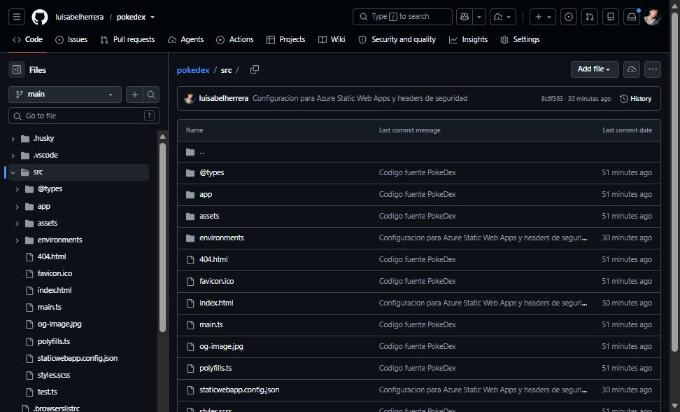

## Paso 3. Crear la Static Web App en el portal de Azure

1. En el portal de Azure buscar **Static Web Apps** y hacer clic en **+ Crear**.
2. Llenar la pestaña **Datos básicos**:

| Campo | Valor |
|---|---|
| Suscripción | Azure subscription 1 |
| Grupo de recursos | *Crear nuevo* → `rg-pokedex-prod` |
| Nombre | `swa-pokedex-portal-prod-lh` |
| Tipo de plan | **Gratis** |
| Origen | **GitHub** → *Iniciar sesión con GitHub* (cuenta `luisabelherrera`) |
| Organización / Repositorio / Rama | `luisabelherrera` / `pokedex` / `main` |
| Valores preestablecidos de compilación | **Angular** |
| Ubicación de la aplicación | `/` |
| Ubicación de la API | *(vacío)* |
| Ubicación de salida | `dist/pokedex-angular` |

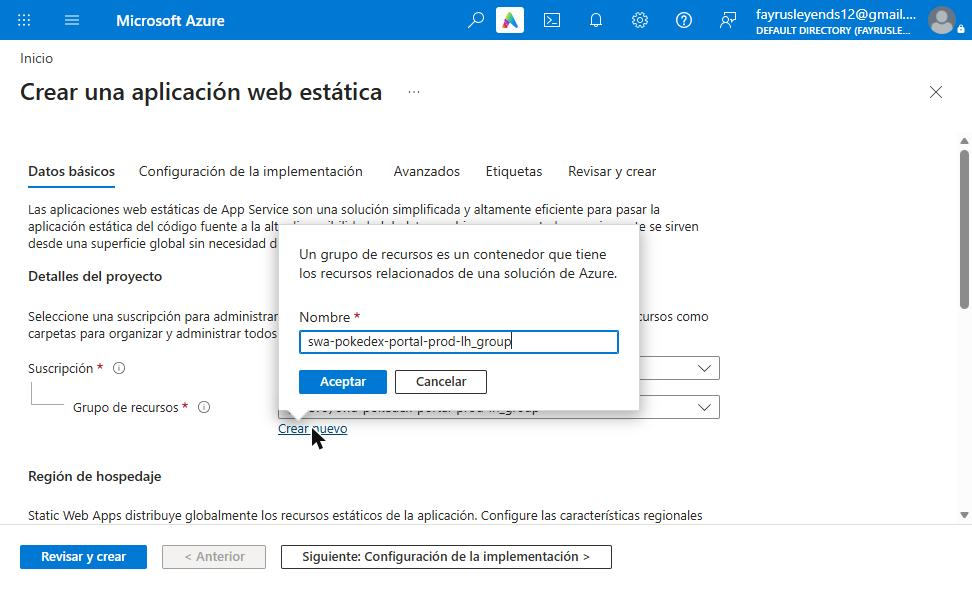
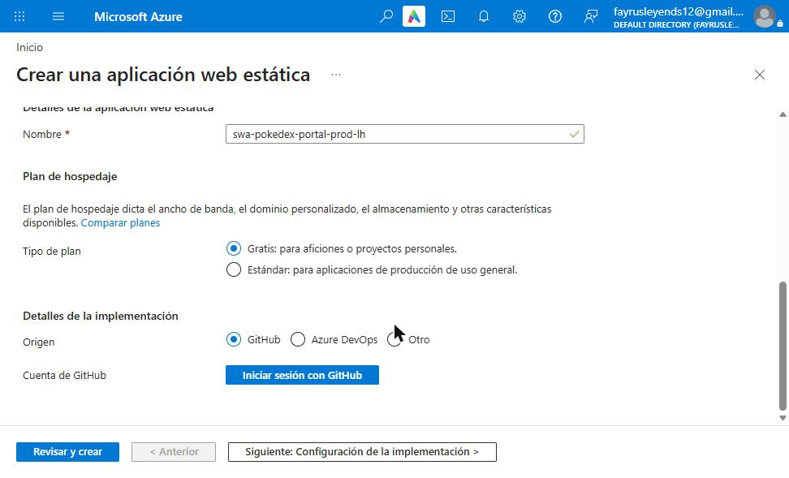
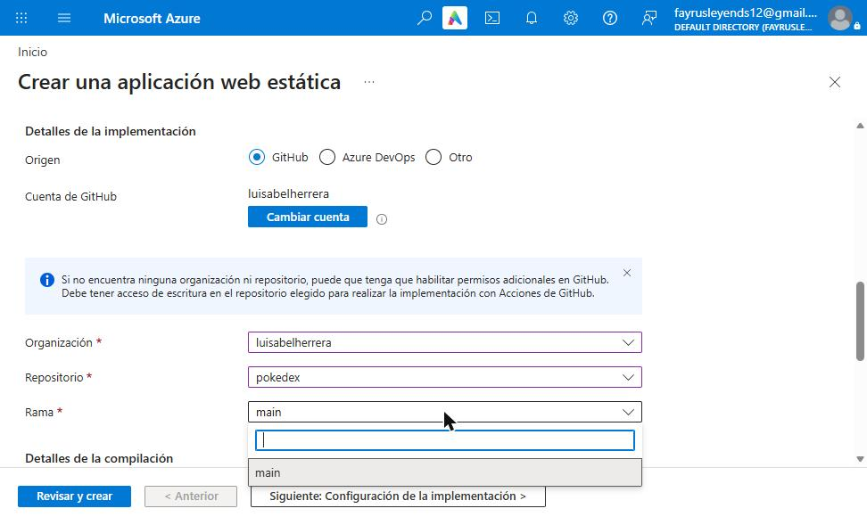
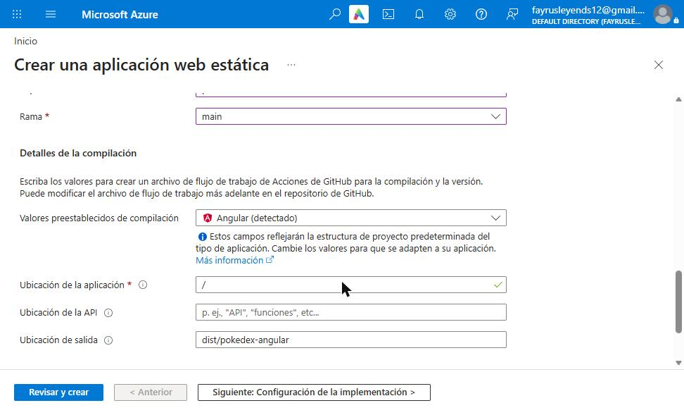

3. Hacer clic en **Revisar y crear** y luego en **Crear**.

   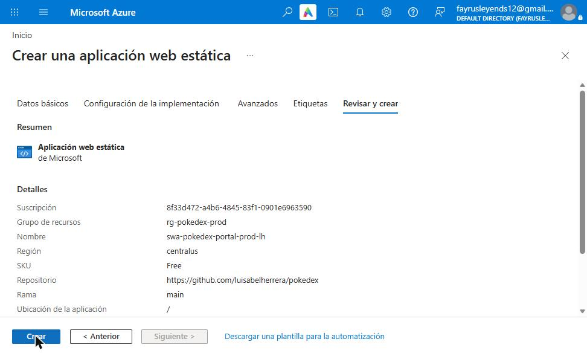

4. Hacer clic en **Ir al recurso**. Ahí aparece la **URL** pública y el workflow de GitHub Actions que Azure agregó al repositorio.

   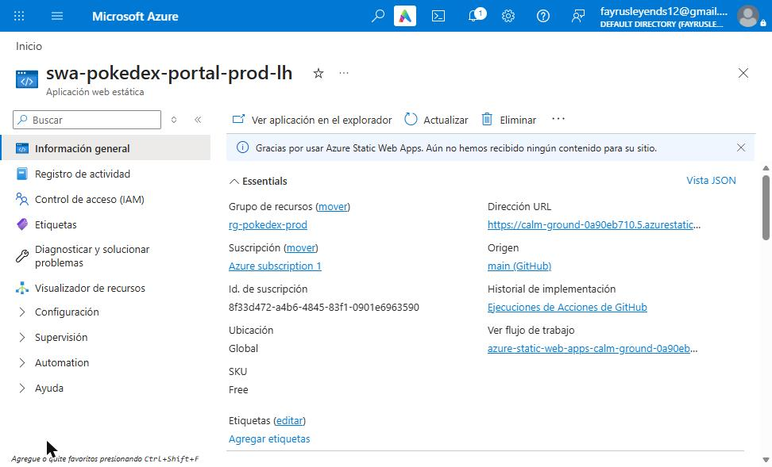

## Paso 4. Problema: GitHub Actions bloqueado

El workflow `azure-static-web-apps-*.yml` falló en 3 segundos con este mensaje:

```
The job was not started because your account is locked due to a billing issue.
```

La cuenta de GitHub tiene un problema de facturación que **bloquea GitHub Actions**; el código no tenía errores. Como alternativa, se desplegó desde **Azure Cloud Shell** con la CLI oficial de Static Web Apps.

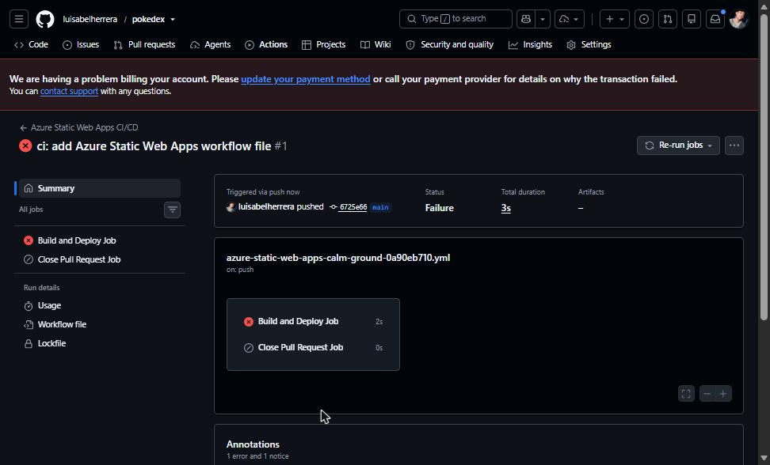

> Si la cuenta de GitHub no tiene ese bloqueo, este paso no es necesario: cada `git push` a `main` despliega automáticamente.

## Paso 5. Despliegue desde Azure Cloud Shell

1. Abrir **Cloud Shell (Bash)** desde el portal. La configuración se explica en el [README](README.md#53-azure-cloud-shell).
2. Clonar y compilar:

   ```bash
   git clone https://github.com/luisabelherrera/pokedex.git
   cd pokedex
   npm ci --no-audit --no-fund --ignore-scripts
   npm run build
   ls dist/pokedex-angular
   ```

   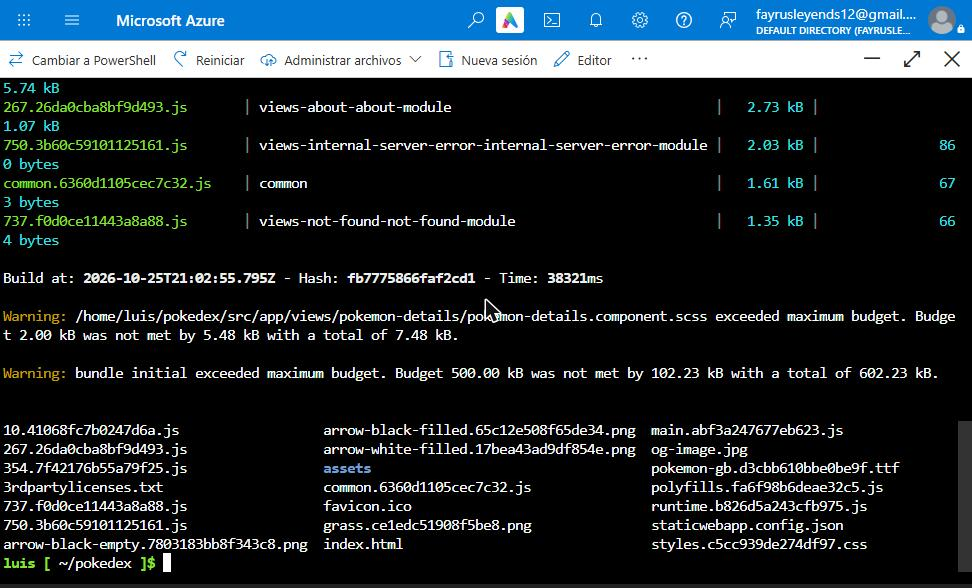

3. Desplegar con la **SWA CLI**. El token de despliegue se obtiene con Azure CLI y se usa sin mostrarlo en pantalla ni guardarlo en el repositorio:

   ```bash
   TOKEN=$(az staticwebapp secrets list \
       -n swa-pokedex-portal-prod-lh -g rg-pokedex-prod \
       --query properties.apiKey -o tsv)

   npx -y @azure/static-web-apps-cli deploy ./dist/pokedex-angular \
       --deployment-token "$TOKEN" --env production

   unset TOKEN
   ```

   > En el primer despliegue la CLI reportó un error de esquema: en `mimeTypes` la clave debe empezar con punto (`".ttf"`, no `"ttf"`). Se corrigió el archivo y se volvió a desplegar.

   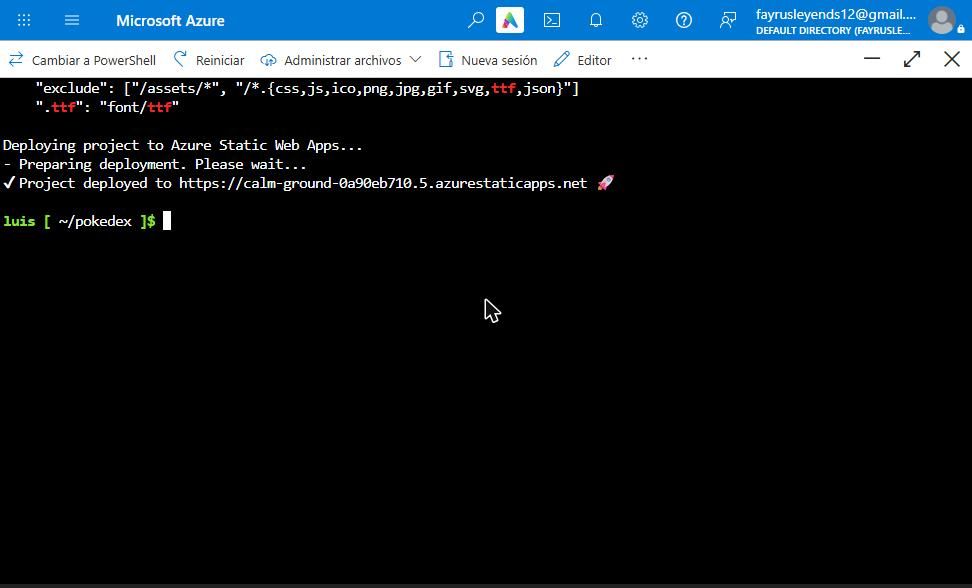

## Paso 6. Verificación

Comprobar los encabezados y las rutas desde Cloud Shell:

```bash
U=https://calm-ground-0a90eb710.5.azurestaticapps.net
curl -sI $U/ | grep -iE "^HTTP|content-security|strict-transport|x-frame|x-content|referrer|permissions|cross-origin"
for p in /assets/images/pokemon-green.png /pokemon/25 /about; do
  echo "$p $(curl -s -o /dev/null -w '%{http_code}' $U$p)"
done
```

Resultado: `HTTP/2 200`, los 7 encabezados presentes y todas las rutas responden `200`.

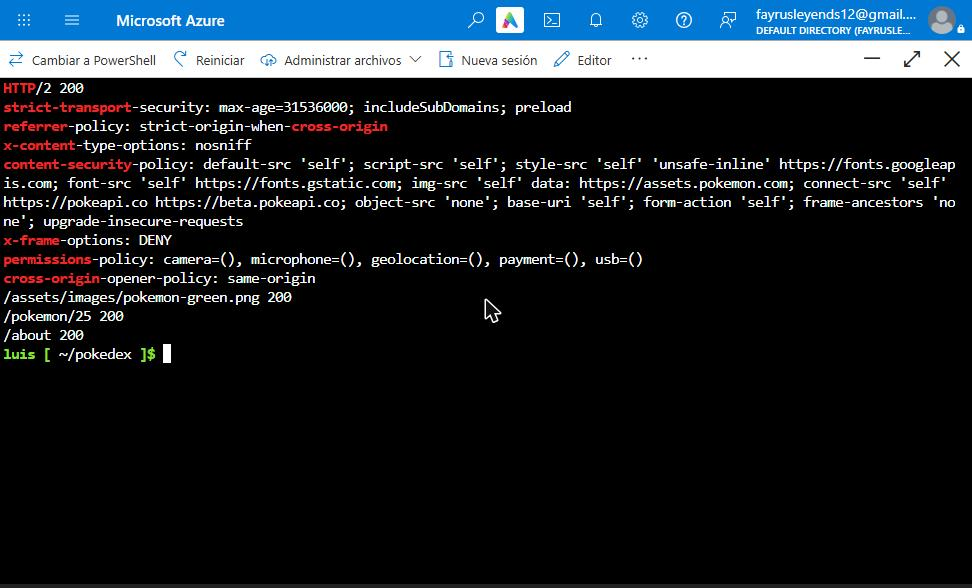

Escaneo de seguridad: ingresar la URL en https://securityheaders.com, marcando *Hide results* y *Follow redirects*.

<!-- Agregar aquí la captura del resultado:  -->

## Resumen de problemas y soluciones

| Problema | Causa | Solución |
|---|---|---|
| `#` y `cp` no funcionan | Se usó CMD de Windows | Usar `xcopy` y omitir comentarios |
| `git push` 403 | Credenciales de otra cuenta guardadas | Usuario en la URL del remoto |
| Imágenes rotas | Ruta de GitHub Pages en `environment.prod.ts` | `imagesPath: '/assets/images'` |
| Cuenta institucional sin suscripción | Azure for Students no activado | Prueba gratuita con cuenta personal |
| GitHub Actions no ejecuta | Cuenta de GitHub bloqueada por facturación | SWA CLI desde Cloud Shell |
| Error de esquema en `mimeTypes` | La clave debía ser `".ttf"` | Corregir y volver a desplegar |
