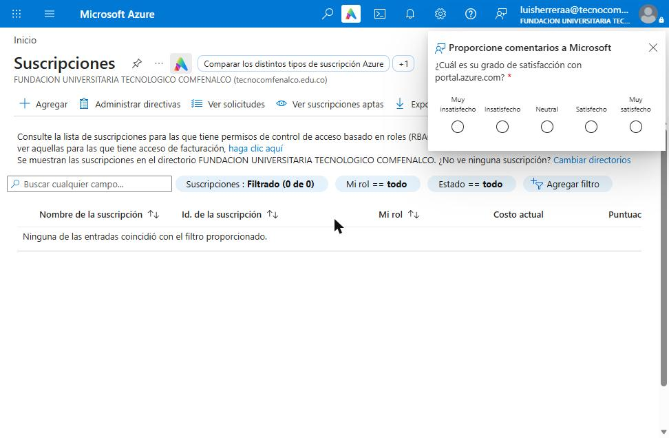
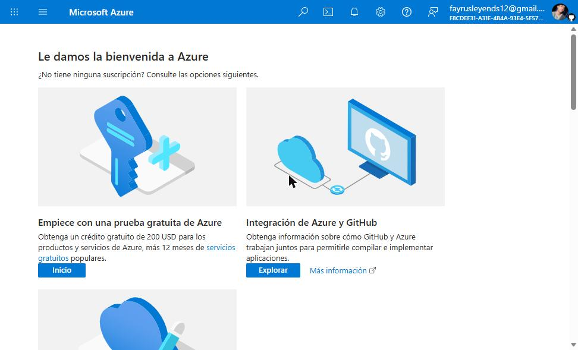
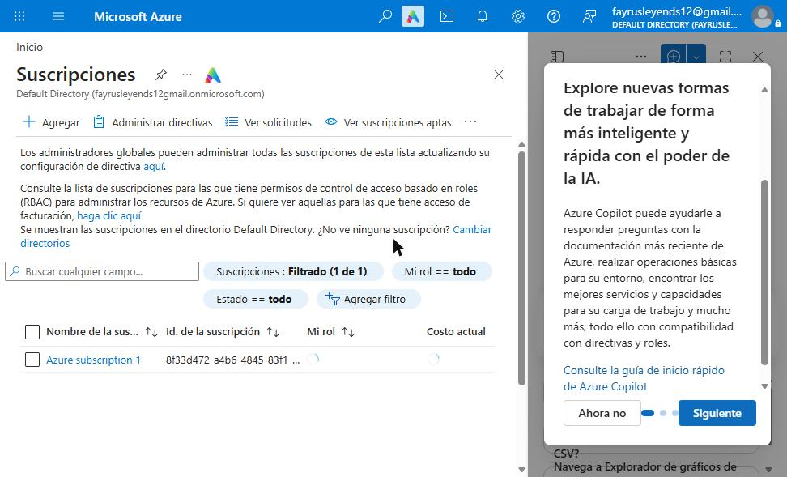
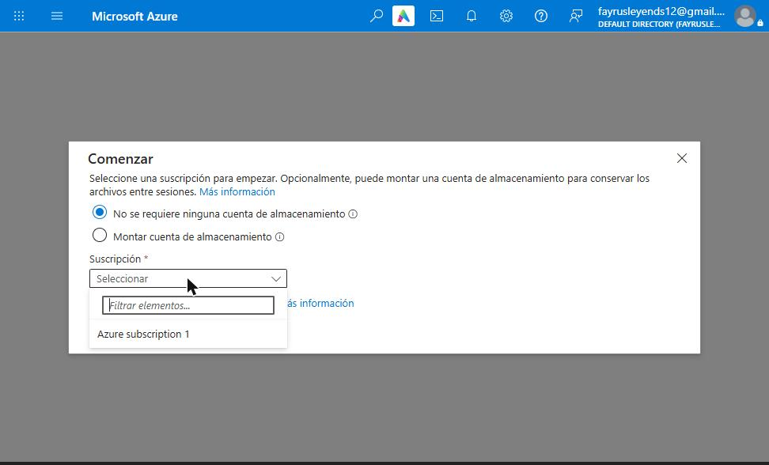

# PokeDex en Microsoft Azure

Despliegue de la aplicación **PokeDex** (Angular), desarrollada por PumasLab para **Pueblo Paleta Inc.**, en **Azure Static Web Apps**.

| | |
|---|---|
| **Estudiante** | Luis Abel Herrera Arrieta |
| **Asignatura** | Computación Distribuida (Clase 2882) — Tecnológico Comfenalco |
| **URL pública** | https://calm-ground-0a90eb710.5.azurestaticapps.net |
| **Nube** | Microsoft Azure — Static Web Apps (plan Gratis) |
| **Guía de despliegue** | [Despliegue.md](Despliegue.md) |

Este README es el **tutorial paso a paso de cómo se creó la cuenta en la nube pública** (Microsoft Azure) y su configuración inicial.

---

## 1. Requisitos previos

- Un correo electrónico de Microsoft (Outlook/Hotmail) o una cuenta institucional.
- Un número de teléfono celular para la verificación por SMS.
- Una tarjeta de crédito o débito, **solo para verificar identidad** en la prueba gratuita. Azure no cobra mientras no se actualice a "pago por uso".
- Una cuenta de GitHub (en este caso: `luisabelherrera`).

## 2. Intento con la cuenta institucional (Azure for Students)

1. Se ingresó a https://portal.azure.com con la cuenta institucional `luisherreraa@tecnocomfenalco.edu.co`.
2. En **Suscripciones** el portal mostró **0 de 0**: la cuenta no tenía ninguna suscripción activa.
3. Sin suscripción no es posible crear recursos en Azure, ni siquiera los gratuitos.

> Con correo institucional se puede activar **Azure for Students** (sin tarjeta) en https://azure.microsoft.com/es-es/free/students. En este caso se optó por la prueba gratuita con cuenta personal.

## 3. Creación de la cuenta con la prueba gratuita de Azure

1. Cerrar sesión en el portal e iniciar sesión con la **cuenta personal de Microsoft**.
2. En la página de inicio, en la tarjeta **"Empiece con una prueba gratuita de Azure"**, hacer clic en **Inicio**.

   

3. Completar el formulario de registro:
   1. **Perfil:** país (Colombia), nombre, correo y teléfono.
   2. **Verificación por teléfono:** solicitar el código por SMS e ingresarlo.
   3. **Verificación de identidad por tarjeta:** ingresar los datos de la tarjeta. Puede aparecer un cargo temporal de verificación que luego se reversa.
   4. Aceptar el **contrato de suscripción** y hacer clic en **Registrarse**.
4. Esperar uno o dos minutos a que se aprovisione la cuenta.

## 4. Verificación de la suscripción

1. En la barra de búsqueda del portal escribir **Suscripciones**.
2. Debe aparecer **"Azure subscription 1"**, que es la suscripción de la prueba gratuita.

## 5. Configuración inicial

### 5.1 Convención de nombres

Siguiendo el documento *"0. Buenas Prácticas en Azure"* (formato `[prefijo]-[aplicación]-[función]-[entorno]`):

| Recurso | Nombre | Explicación |
|---|---|---|
| Grupo de recursos | `rg-pokedex-prod` | `rg` + aplicación + entorno |
| Static Web App | `swa-pokedex-portal-prod-lh` | `swa` + aplicación + módulo + entorno + iniciales (Luis Herrera) |

### 5.2 Control de costos

- Se usa el plan **Gratis (Free)** de Static Web Apps: 0 USD.
- **No** se debe hacer clic en "Actualizar a pago por uso".
- El costo se puede revisar en **Administración de costos + facturación**.

### 5.3 Azure Cloud Shell

Cloud Shell se usó para compilar y desplegar la aplicación:

1. Hacer clic en el ícono **`>_`** de la barra superior del portal.
2. Elegir **Bash**.
3. Seleccionar **"No se requiere ninguna cuenta de almacenamiento"**, que crea una sesión efímera sin costo.
4. Elegir la suscripción **Azure subscription 1** y hacer clic en **Aplicar**.

---

Continúa en **[Despliegue.md](Despliegue.md)**: el proceso completo de despliegue de la PokeDex en Azure.
